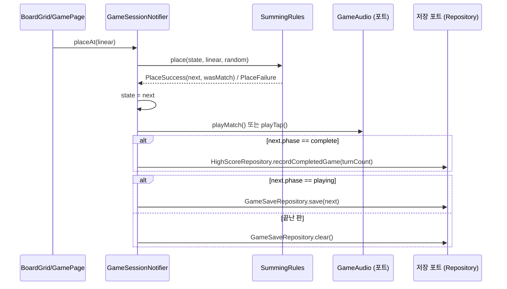

# 데이터 흐름

## 한 수 두기 (`GameSessionNotifier.placeAt`)

- `PlaceFailure`이면 아무것도 바뀌지 않습니다.
- 효과음은 디스크 저장보다 먼저 재생합니다.
- application은 포트(`ports.dart`)만 호출하며, 구현은 `appOverrides`가 `ProviderScope`에 주입합니다.

## 세션 시작·복원
- `startNewGame`: `GameState.initial` 생성 후 즉시 저장
- `resumeGame`: 저장본을 읽고, `playing`이 아니면 저장을 지우고 복원하지 않음
- `restartGame`: `startNewGame`과 동일 (확인 없이 저장 덮어씀)

## 저장 키
`summing_settings`, `summing_savegame`(`schemaVersion` 1 JSON), `summing_highscores`(상위 5개)
