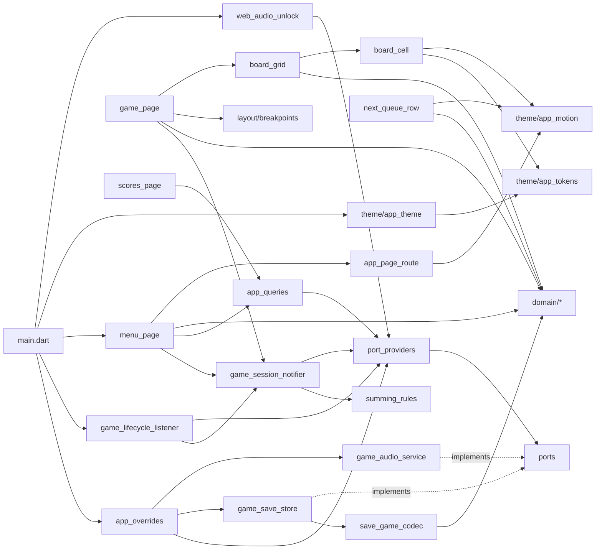

# 의존 관계

## 외부 패키지
| 패키지 | 사용 위치 |
|--------|-----------|
| `flutter_riverpod` | `main.dart`, application, `*_providers.dart`, `app_overrides.dart`, presentation |
| `shared_preferences` | `infrastructure/persistence/*_store.dart`, `local_persistence.dart` |
| `audioplayers` | `infrastructure/audio/` |
| (폰트 에셋) | Nunito — `pubspec.yaml` `fonts:`, `AppTheme`이 사용 |
| `meta` | `domain/`(`board`, `game_state`, `next_queue`, `summing_cell`), `app_settings.dart` |

## 내부 import (부분 목록, 확인된 것)

`application`→`infrastructure`, `presentation`→`infrastructure` 직접 참조는 없습니다. `infrastructure`가 `application`의 포트를 구현하는 방향이며, 연결은 `app_overrides.dart`가 맡습니다(경계 검사: `test/architecture/layer_boundary_test.dart`).
