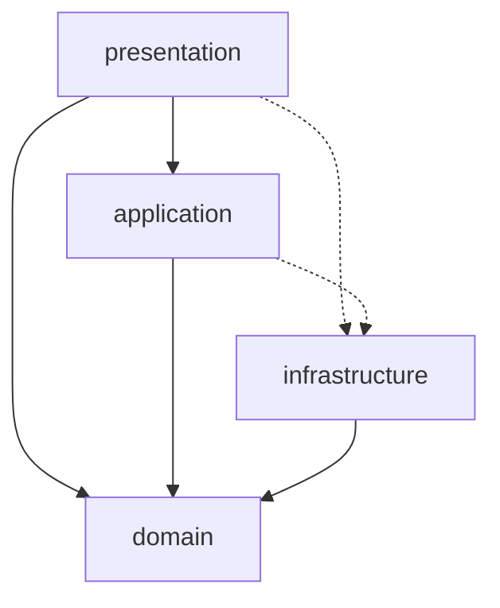

# 프로젝트 구조

## 디렉터리

```
lib/
  main.dart                      # ProviderScope + MaterialApp, 오디오 초기화
  domain/                        # 순수 Dart 게임 규칙 (Flutter 비의존)
    cell_index.dart  summing_cell.dart  board.dart  next_queue.dart
    game_phase.dart  game_state.dart  place_outcome.dart  summing_rules.dart
    summing_domain.dart          # barrel
  application/
    game_session_notifier.dart   # gameSessionProvider
    application.dart             # barrel
  infrastructure/
    persistence/                 # shared_preferences 기반 저장소
      persistence_keys.dart app_settings.dart settings_store.dart
      game_save_store.dart high_scores_store.dart save_game_codec.dart
      local_persistence.dart persistence_providers.dart
    audio/
      game_audio_assets.dart game_audio_service.dart audio_providers.dart
    infrastructure.dart          # barrel
  presentation/
    menu/menu_page.dart
    game/game_page.dart  game/widgets/{board_grid,next_queue_row}.dart
    scores/scores_page.dart
    common/{how_to_play_sheet,game_lifecycle_listener}.dart
    presentation.dart            # barrel
test/                            # domain / application / infrastructure / presentation
assets/audio/                    # bg_music.mp3, tap_sound.wav, clap_sound.wav
web/ android/ ios/               # 플랫폼 러너 (web 우선)
tools/convert_ios_aiff_to_wav.py
run_chrome.sh / run_chrome.ps1   # 고정 포트 웹 실행 스크립트
```

## 계층 의존 관계 (현재 상태)

실선은 허용된 의존, 점선은 현재 코드에 있지만 개선 대상인 의존입니다.



- `domain`은 Flutter와 I/O에 의존하지 않으며, 외부 패키지는 `meta`(`@immutable`)만 사용합니다.
- `presentation`은 `domain`의 타입(`game_phase`, `game_state`, `cell_index`, `summing_cell`, `next_queue`)을 직접 참조합니다. 화면이 상태를 그리는 데 필요한 읽기 전용 참조로 보고 허용합니다.
- `application`과 `presentation`이 `infrastructure`의 구체 provider를 직접 참조하는 점선 간선은 개선 후보입니다. `menu_page.dart`는 provider 외에 구체 타입 `AppSettings`와 `LocalPersistence`도 직접 사용합니다.

## 테스트 배치 (11개 파일)

| 영역 | 파일 |
|------|------|
| domain | `board_test`, `cell_index_test`, `next_queue_test`, `summing_rules_test` |
| application | `game_session_notifier_persistence_test` |
| infrastructure | `game_save_store_test`, `high_scores_store_test`, `save_game_codec_test`, `settings_store_test` |
| presentation | `common/game_lifecycle_listener_test` |
| 루트 | `widget_test` (`test/widget_test.dart`, 앱 스모크) |

테스트가 없는 영역: `GameAudioService`, `GamePage`/`BoardGrid`/`ScoresPage` 위젯. `MenuPage`는 `widget_test`의 스모크 렌더링('Summing', 'New Game' 텍스트 확인) 외에 동작 테스트가 없습니다.
