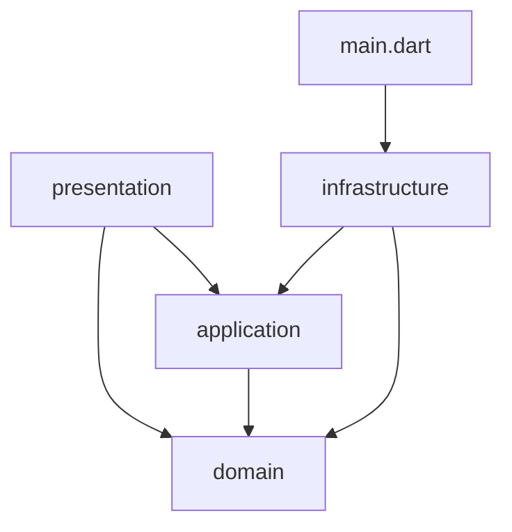

# 프로젝트 구조

## 디렉터리

```
lib/
  main.dart                      # ProviderScope(overrides: appOverrides) + MaterialApp, 오디오 초기화
  domain/                        # 순수 Dart 게임 규칙 (Flutter 비의존)
    cell_index.dart  summing_cell.dart  board.dart  next_queue.dart
    game_phase.dart  game_state.dart  place_outcome.dart  summing_rules.dart
    summing_domain.dart          # barrel
  application/
    ports.dart                   # 추상 포트: GameSaveRepository, HighScoreRepository, SettingsRepository, GameAudio
    port_providers.dart          # 포트 provider (기본은 미바인딩, composition root가 override)
    app_queries.dart             # resumableGameProvider, highScoresProvider, settingsControllerProvider
    models/app_settings.dart     # 설정 값 객체 (application 소유)
    game_session_notifier.dart   # gameSessionProvider
    application.dart             # barrel
  infrastructure/
    app_overrides.dart           # appOverrides: 포트 → 구현 연결 목록 (composition root)
    persistence/                 # shared_preferences 기반 저장소
      persistence_keys.dart app_settings.dart settings_store.dart  # app_settings: application 모델 re-export
      game_save_store.dart high_scores_store.dart save_game_codec.dart
      local_persistence.dart persistence_providers.dart
    audio/
      game_audio_assets.dart game_audio_service.dart audio_providers.dart
    infrastructure.dart          # barrel
  presentation/
    menu/menu_page.dart
    game/game_page.dart
    game/widgets/{board_grid,board_cell,next_queue_row,game_side_panel,end_overlay,restart_confirm_dialog}.dart
    scores/scores_page.dart
    common/{how_to_play_sheet,game_lifecycle_listener,app_page_route,web_audio_unlock}.dart
    theme/{app_tokens,app_theme,app_motion}.dart   # 파스텔 토큰(AppPalette 등), ThemeData, 연출 시간
    layout/breakpoints.dart      # LayoutClass(compact/medium/expanded/저높이 가로), 화면별 배치 값
    presentation.dart            # barrel
test/                            # domain / application / infrastructure / presentation / architecture
assets/audio/                    # bg_music.mp3, tap_sound.wav, clap_sound.wav
assets/fonts/                    # Nunito-Regular.ttf, Nunito-ExtraBold.ttf, OFL.txt
web/ android/ ios/               # 플랫폼 러너 (web 우선)
tools/convert_ios_aiff_to_wav.py
run_chrome.sh / run_chrome.ps1   # 고정 포트 웹 실행 스크립트
```

## 계층 의존 관계 (현재 상태)



- `domain`은 Flutter와 I/O에 의존하지 않으며, 외부 패키지는 `meta`(`@immutable`)만 사용합니다.
- `presentation`은 `domain`의 타입(`game_phase`, `game_state`, `cell_index`, `summing_cell`, `next_queue`)을 직접 참조합니다. 화면이 상태를 그리는 데 필요한 읽기 전용 참조로 보고 허용합니다.
- `application`은 `ports.dart`의 추상 포트에만 의존하고, `infrastructure`의 저장소·오디오가 이 포트를 `implements` 합니다(의존 역전).
- `application`·`presentation`은 `infrastructure`를 import하지 않습니다. 구현 연결은 `lib/infrastructure/app_overrides.dart`의 `appOverrides`를 `lib/main.dart`가 `ProviderScope`에 넘기는 방식으로만 이뤄집니다.
- 이 경계는 `test/architecture/layer_boundary_test.dart`가 검사합니다.

## 테스트 배치 (36개 테스트 파일, 363개 테스트)

| 영역 | 파일 |
|------|------|
| domain | `board_test`, `cell_index_test`, `next_queue_test`, `summing_rules_test` |
| application | `app_queries_test`, `app_settings_json_test`, `game_session_notifier_test`, `game_session_notifier_persistence_test`, `port_providers_test` |
| infrastructure | `app_overrides_test`, `game_save_store_test`, `high_scores_store_test`, `save_compat_fixture_test`, `save_game_codec_test`, `settings_store_test` |
| presentation | `common/game_lifecycle_listener_test`, `common/lifecycle_audio_test`, `common/app_page_route_test`, `common/web_audio_unlock_test`, `game/game_page_characterization_test`, `game/game_page_test`, `game/board_grid_test`, `game/cell_effects_test`, `game/next_queue_row_test`, `game/restart_dialog_test`, `layout/breakpoints_test`, `responsive_layout_test`, `theme/{app_theme,app_motion,token_contrast,screen_contrast,web_manifest}_test`, `menu/menu_page_test`, `scores/scores_page_test` |
| architecture | `layer_boundary_test` (계층 import 경계) |
| 지원·루트 | `support/test_overrides.dart`(헬퍼), `widget_test`(앱 스모크) |

테스트가 약한 영역: `GameAudioService`(실제 오디오 재생은 기기·웹에서 확인하지 않음), `main.dart`(커버리지 9/14줄, `main()` 진입부 미실행). `lib/presentation` 커버리지는 99.43%(703/707).
